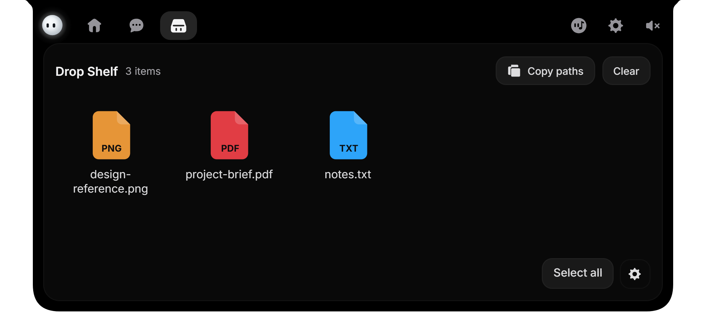
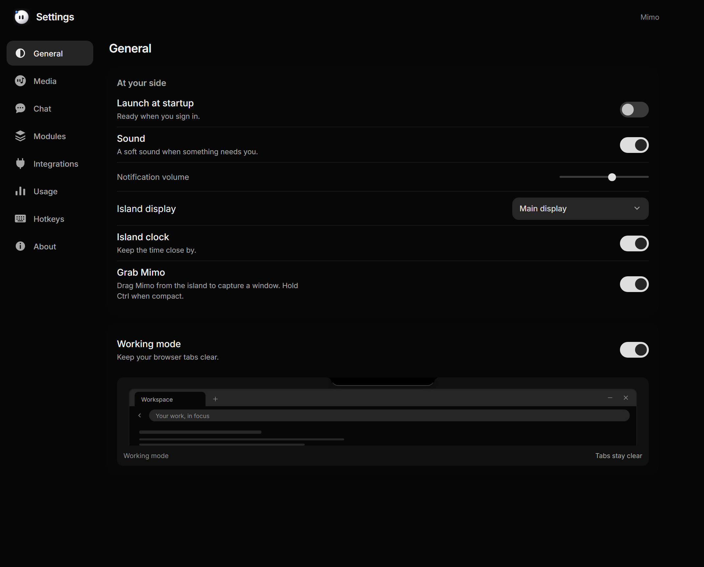
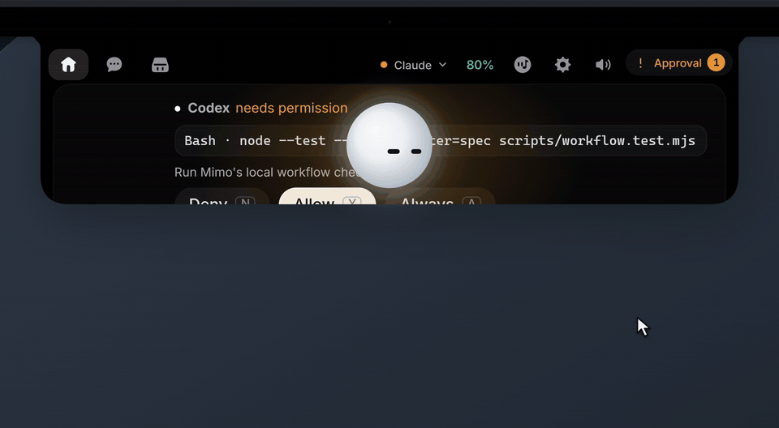
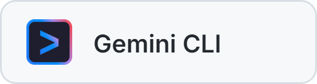
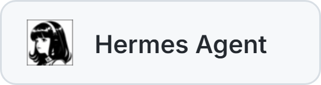

<h1 align="center">Mimo</h1>

<strong>A little company. A lot within reach.</strong>

  Your coding agents, files, conversations and music. 
  A small companion in the notch at the top of your Windows desktop.

  
  
  
  

  <a href="https://github.com/Jiocode1/mimo/raw/refs/heads/main/downloads/Mimo-Windows-setup.exe"><strong>Download for Windows</strong></a>
  · <a href="docs/README.md">Documentation</a>
  · <a href="https://github.com/Jiocode1/mimo/issues">Report a bug</a>

> **Windows 10 / 11 · v1.0.1 · 64-bit.** The installer is **not code-signed yet**.
> Windows may show an unknown-publisher or SmartScreen notice.
> [SHA-256 checksum](downloads/SHA256SUMS.txt) · [Build from source](#build-and-run)

[Features](#features) | [Install](#install) | [Connect your tools](#how-it-connects) | [Supported agents](#supported-agents) | [Things to try](#things-to-try)

## Install

| Platform | Availability |
| --- | --- |
| Windows 10 / 11, 64-bit | [Download v1.0.1](https://github.com/Jiocode1/mimo/raw/refs/heads/main/downloads/Mimo-Windows-setup.exe) |
| Android | Coming soon |

1. [Download Mimo-Windows-setup.exe](https://github.com/Jiocode1/mimo/raw/refs/heads/main/downloads/Mimo-Windows-setup.exe).
2. Run the installer and follow the setup steps.
3. Open Mimo from the Start menu, then hover over it at the top of your screen.
4. Open Settings to connect your coding tools, chat provider or services.

You need Windows 10 or 11, 64-bit, and WebView2. The installer is not code-signed
yet, so Windows may show an unknown-publisher or SmartScreen notice. You can
verify the [SHA-256 checksum](downloads/SHA256SUMS.txt) or
[build from source](#build-and-run).

## Features

Mimo lives in a small notch at the top of your Windows screen. Hover to open it
and reach your coding activity, conversations, files and music. When you are
done, it settles back into a compact companion.

  

### Coding agents

- 🧑‍💻 **Coding sessions.** See which agent is working, its project and its current
  activity in the notch. Open a session to follow its progress without switching
  back to the terminal. The Home card keeps the active task close to your work.
  Switch sessions when you need another project; its requests and answers stay
  separate from the others.
- 🖥️ **Live terminal.** Open the coding card to inspect commands and output, copy
  results. The session stays attached to the agent that produced it. Edits stay
  above command output in one workspace. Passing tests show a compact PASS card
  with reported totals and duration. Open Details to see the available test names.
  When an agent supplies token counts, the card labels them by prompt, response
  or session.
- 📝 **File edits.** Review the files your agent changes, with added and removed
  lines, syntax colors and source line numbers when the agent reports them. The
  coding panel groups changes by file so you can understand an edit before going
  back to your editor. It shows the changes supplied by the agent, rather than
  guessing what happened.
- 🛂 **Permissions.** Check the requested tool and command in the notch, then allow
  or deny supported requests. Always allows the same exact action again within
  that agent session and workspace. You keep the final say before the agent continues. A
  pending request opens the relevant panel and waits for your decision. When a tool
  cannot use this reply path, its terminal remains the place to approve the action.
- ❓ **Agent questions.** Answer a supported agent's question from its session.
  Choose an option, select multiple answers when offered or type your own reply. The
  question appears inside Mimo with the options supplied by the tool. An unfinished
  reply stays available while you review other work, and is sent back to its own
  session.
- 📥 **Review queue.** Open Review to find pending requests and unfinished answers.
  Each item stays with the right session so you can pick it up later. The notch can
  show that something needs your attention even when another panel is open. Review
  gives those decisions a shared place without mixing the conversations they belong
  to.
- 📊 **Usage and capacity.** Check reported limits and remaining capacity for
  supported coding connections, close to the work they belong to. The header shows
  the selected agent and its reported remaining capacity. Open Limits for available
  session and weekly meters, reset times and reset credits; information the provider
  does not share stays marked as unavailable.
- 🔧 **Hook setup.** Connect an agent from Settings. Preview its configuration
  changes, keep a backup and apply the hooks for your selected provider. Settings
  shows the connection file and the changes Mimo would make before you apply them.
  Activity hooks and optional MCP questions have separate setup steps because they
  provide different capabilities.

### Connected services

Enable a service in Settings to bring its updates into the notch. Each
connection uses your own credentials and the data your account can access.

- 🐙 **GitHub.** Check repositories, contribution activity, pull requests, reviews,
  issues and checks from your connected account. The notch can show a contribution
  heatmap and account activity alongside your other work. Open the connected service
  to inspect the available repository, review and status details without visiting
  several pages.
- 🚀 **Vercel.** See recent deployments and their status without opening a separate
  dashboard. Deployment updates appear in the connected-service area, bringing
  recent project activity close to your coding session. You can check the reported
  result before returning to your work.
- 💳 **Stripe.** Check your balance, recent payments and their status. The service
  view puts the available balance and recent payment information in the notch. It is
  a quick account summary backed by the access granted to your Stripe connection.
- ✉️ **Resend.** Follow recent emails and their delivery states. Delivery
  information appears with the connected-service activity, so you can see how recent
  messages are progressing. The details come from the Resend account you connected
  in Settings.
- 📄 **Notion.** See the pages your connection can access and when they were last
  edited. The service brings a small view of accessible pages into Mimo rather than
  copying your entire workspace. Last-edited information helps you recognize recent
  activity before opening the page you need.
- 📅 **Cal.com.** Check upcoming bookings and today's schedule. Bookings appear in
  the connected-service view so your schedule stays close to the work in progress.
  Mimo shows what the connected account can access, including upcoming events and
  the current day.
- ⚙️ **n8n.** Follow workflows, recent executions and failed runs. Execution status
  gives you a quick way to spot a workflow that needs attention. The notch presents
  the reported runs and failures beside your other enabled integrations.

[Integration guide](docs/integrations.md).

### Drop Shelf

Keep files and references within reach. Drop a file into Mimo and choose Drop
Shelf, then select the files you need and copy their paths.

   
  Keep files and references within reach.

### Desktop and preferences

   
  Choose how Mimo fits your desktop.

- 🏠 **Home.** Keep enabled coding, service and media modules together in the notch.
  Chat and Mimo Shelf have their own tabs alongside it. Home is the shared starting
  point for the tools you enable. It brings their summaries together while leaving
  conversations and collected references in the dedicated Chat and Shelf views.
- 🫧 **Compact notch.** Keep useful activity and Review close to the screen edge
  while leaving more space for your work. The compact state is the small resting
  view between interactions. Hover or open the relevant activity when you need
  details, then let Mimo settle back while you continue working.
- 🧘 **Working mode.** Reduce Mimo to a thin lip at the top of the screen. Requests
  that need an answer can still open when they arrive. This keeps the companion out
  of the way during focused work without hiding a decision that needs you. The
  smaller appearance is a preference you can switch in Settings.
- 📍 **Placement.** Mimo stays centered at the top of its display. Choose the
  primary display or the screen under your pointer in Settings.
- 🕒 **Notch clock.** Show or hide the clock in the compact notch. The clock adds a
  quick time check to the resting view. Turn it off when you prefer the companion
  and activity indicators to have the space to themselves.
- 🔔 **Notifications.** Choose coding and service notifications, set their sound
  volume or snooze them when you need some quiet. Notification preferences decide
  which updates should interrupt you and how they sound. Snoozing gives you a
  temporary quiet period without requiring you to disconnect your tools.
- ⌨️ **Shortcuts.** Configure work and voice shortcuts in Settings. Mimo tells you
  when a shortcut conflicts with another registration. Keyboard access lets you
  reach voice, pending work and capture without moving to the screen edge first.
  Conflict feedback helps you choose a combination Windows can register.
- ⚙️ **Modules and startup.** Choose which modules appear on Home, enable Grab and
  decide whether Mimo starts with Windows. These preferences shape what Mimo
  presents each day. Keep the Home modules you use, choose whether capture is
  available and decide if the companion should be ready when Windows starts.
- 🤖 **Companion.** Watch Mimo follow your pointer, react to music and respond to a
  poke, with expressions that reflect what's happening. Expressions and small
  reactions make the notch feel less static while still reflecting its current
  activity. Try hovering, playing music or tapping Mimo to see the different
  responses.
- 🎶 **Original sounds.** Hear Mimo's 28 sound cues as you interact, or turn sounds
  off in Settings. The cues give clicks, file intake, approvals and other
  interactions a short audible response. Sound and volume preferences let you keep
  that feedback gentle or use Mimo quietly.
- 🔐 **Local storage.** Keep settings, drafts and Shelf files on your computer.
  Credentials stay in Windows Credential Manager. The local workspace keeps those
  items available between sessions. Connected services and AI providers still
  receive the requests required for their enabled features, using your selected
  accounts.

Watch Mimo in motion

  

The previews come from the approved launch promo and use local demo data.
[Media details](docs/media/README.md).

## How it connects

| Connection | Setup |
| --- | --- |
| Coding agents | Open Settings, choose your coding provider and review its hook setup. Apply the changes when ready; Mimo keeps a configuration backup. Follow any MCP question instructions shown for your tool. |
| AI chat | Open Settings → Chat, choose a provider and add its API key. For Ollama, run the local service and install your chosen model. Select the model in Chat. |
| Voice | Choose a speech service in Settings → Chat. Automatic can use an eligible saved speech connection; spoken replies have their own switch. |
| Connected services | Open Settings → Integrations, enable a service and enter its credentials. Mimo shows the data your account can access. |
| Music and audio | Start playback in a compatible Windows app, then open Now playing in Mimo. Playback metadata, devices and audio sessions come from Windows. |

Coding events use a local connection. Chat, speech and enabled services use your
selected accounts and their quotas. Keys and service tokens stay in Windows
Credential Manager. Chat settings are independent from coding connections.

## Supported agents

Connect your coding tools from Settings. Their activity appears in the notch,
and each session keeps its own project, requests and replies.

  
  
   
  
  
   
  
  
  

- **Claude Code** uses local activity hooks and supported native permission and
  question handling.
- **Codex** uses local activity hooks, with optional MCP questions.
- **Cursor, Gemini CLI, Antigravity, Muse Code, OpenCode, Copilot CLI and Hermes
  Agent** use provider-specific hooks or observer plugins. MCP questions need a
  client that supports the connection and calls Mimo's question tool.

Activity, permissions and replies depend on each tool's capabilities. Settings
shows the connection steps for your selected provider.
[Coding-agent guide](docs/agents.md).

## Things to try

| Try this | What happens |
| --- | --- |
| 👋 Hover over Mimo | The notch opens so you can reach your work, chat and files. |
| 👆 Tap Mimo three times | See its brief confused reaction, then watch it settle. |
| 📎 Drag a file into the notch | Mimo takes it in and offers Chat or Drop Shelf. |
| 🎙️ Press Ctrl+Alt+V and say something | Talk in the voice panel, then press the shortcut again to send. Esc cancels. Connect a speech service first. |
| 📸 Try Mimo Grab | Enable Grab Mimo in Settings, then drag Mimo from the notch. Hold Ctrl when compact, or use Ctrl+Alt+G to start capture. |

## Shortcuts

| Shortcut | Action |
| --- | --- |
| Ctrl+Alt+M | Open the next work item that needs attention |
| Ctrl+Alt+V | Open desktop voice; press again to send |
| Ctrl+Alt+G | Start native capture |
| Y / N / A | Allow, deny or always allow a focused permission request |
| Esc | Cancel the active interaction or minimize one notch step |
| Tab / Shift+Tab | Move between controls |

## Build and run

You need Windows 10 or 11, WebView2, Node.js 20+, Rust and MSVC C++ build tools.

~~~powershell
git clone https://github.com/Jiocode1/mimo.git
cd mimo/windows
npm ci
npm run tauri dev
~~~

Run `npm run pack` from `windows/` to build the installer.
[Windows development guide](windows/README.md) · [Architecture](docs/architecture.md) ·
[Download and verification](docs/distribution.md)

## Your connections, your choice

Credentials stay in Windows Credential Manager. Settings and Shelf files are
stored locally. Enabled AI providers and services receive the requests needed
for their features and use your accounts and quotas.
[Privacy and data flow](docs/privacy.html).

## Contribute

[Report an issue](https://github.com/Jiocode1/mimo/issues),
[contribute a fix](.github/CONTRIBUTING.md), or improve the docs.
Mimo is maintained by [John Paul](https://github.com/Jiocode1).

Read the [contribution rules](.github/CONTRIBUTING.md),
[support guide](.github/SUPPORT.md) and [security policy](.github/SECURITY.md).

## License

**Fork it. Learn from it. Ship it.**

- **Code, by John Paul.** Application code and tools use the [MIT license](LICENSE).
  You can study, modify and distribute them, including commercially, while
  keeping the required notices.
- **Mimo's assets are protected.** Its name, mascot, artwork and original sound
  recordings have [separate asset terms](LICENSE-ASSETS.md). Use your own
  branding and assets when shipping a fork. Earlier asset grants retain their
  original terms.

[Credits and third-party licenses](legal/README.md)

  If Mimo made your day a little brighter, <a href="https://github.com/Jiocode1/mimo">a star</a> would mean a lot. ⭐

